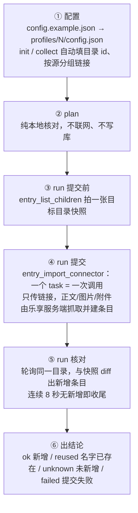

# sync-multisource-doc-to-lexiang

把**企业微信 / 飞书 / 钉钉 / 腾讯文档个人版**的在线文档，批量或增量导入乐享知识库的指定目录。

**一句话**：你只给链接，乐享服务端自己去抓正文、图片、附件并建条目 —— Agent 不读正文、不下载、不上传。

当前版本：`1.0.0`（变更记录见 [CHANGELOG.md](CHANGELOG.md)）。

---

## 它解决什么问题

团队文档散落在四个外部平台，要统一沉淀到乐享时，常见的做法是让 Agent 逐篇打开、读正文、下载图片附件、再调文档接口重建一遍。这条路有四个硬伤：

| 痛点 | 后果 |
|---|---|
| 正文要过一遍模型 | 慢、费 token，长文档还会截断 |
| 图片 / 附件要下载再上传 | 容易丢、容易错位，格式还原差 |
| 每个平台的解析逻辑都不同 | 四种源写四套代码，边界用例无穷无尽 |
| 重复跑会造重复条目 | 增量同步没法做，定时任务更不敢开 |

这个 skill 换了一条路：**导入能力本来就在乐享服务端**（`entry_import_connector`），脚本只负责把「往哪导、导什么」讲清楚并提交链接。于是：

- Agent 全程只碰**链接清单**，不碰文档内容 —— 零 token 消耗，格式由服务端原样还原；
- 四种源统一成一份配置，新增源只是多写一个 `task`；
- `conflict_strategy: skip` 让重复跑天然幂等，配置做一次、之后每次只跑一次 `run`，适合定时增量同步；
- 链接清单可以直接托管在乐享文档里，脚本自己读、自己按域名分源，不用手抄。

> **它不是什么**：不是文档解析器，不是迁移后的内容校对工具，也不做跨平台的权限/评论/协作关系迁移。它做的是「把源端链接变成乐享目录里的条目」。

---

## 实现机制



### 谁干什么

| 角色 | 职责 |
|---|---|
| **Agent** | 填配置（目标目录 + 链接清单）、跑 `plan` / `run` / `status`、读结论汇报。**不读正文** |
| **本地脚本** | 校验配置 → 从乐享清单页抽链接并按域名分源 → 把 `{type, files}` 转成接口要的顶层 oneof → 提交 → 目录前后比对 → 汇总 |
| **乐享服务端** | 按租户级授权去源端拉正文 / 图片 / 附件、建条目、按 `conflict_strategy` 去重 |

### 为什么长成这样（都是 2026-11-11 接口换形后的实测约束）

| 接口事实 | 脚本的应对 |
|---|---|
| 建任务与查状态合并成 `entry_import_connector`，**回包只有 `task_id`**：没有状态查询、没有 `failed_items`、没有进度 | 判断「进没进库」的**唯一硬指标是目标目录前后比对**。脚本不猜、不把「没新增」说成「已存在」 |
| **`dry_run` 被忽略**：传了照样真写库 | `run --dry-run` 直接拒绝执行（退出码 2）；要预览只能走离线的 `plan` |
| **提交阶段几乎不校验链接**：好链接和坏链接放一批照样拿到 `task_id` | 坏链接只表现为 `unknown`；自动拆单兜底**只在调用本身报错时触发**，不指望它揪出「内容导不了」 |
| **一个任务只能一个源**：混源回 `SelectionNotImportable`，整任务被拒 | 配置里一个源一个 `task`，同源链接全收进同一个 `files` 数组 |
| 入参是**顶层 oneof**：`{"txdoc": {"files": […]}}`，不是 `{type, files}` | 配置保持人好读的形状，提交前由 `import_args()` 转换；写错形状只会得到一句看不懂的 oneof 报错 |
| 服务端抓取内容 | Agent 不下载、不上传，脚本也没有任何正文处理逻辑 |

> 结果口径的关键是 **`unknown`**：提交成功但目录没新增，可能是 `skip` 去重，也可能压根没入库。接口不给答案，脚本就不硬判 —— 请先跑 `status` 看目录实况。

---

## 支持与边界

| 源 | `type` | 说明 |
|---|---|---|
| 企业微信 | `wecombot` | doc / smartpage / 微盘分享链接可导；sheet、mind 回 `unsupported_file_type` |
| 飞书 | `feishu` | 知识库 / wiki 节点 / docx 可导；老版 `/docs/` 链接回 `SelectionNotImportable` |
| 钉钉 | `dingtalk` | 目录会展开子节点；脑图导不了 |
| 腾讯文档**个人版** | `txdoc` | `docs.qq.com/doc/`、`/sheet/` 可导；`/aio/` 智能文档不支持 |
| 腾讯文档**企业版** | — | `saas.docs.qq.com` **不支持**，`collect` / `plan` 会提前标出来 |

**前提**：乐享侧必须先配好对应源的**租户级连接器授权**，否则任务提交成功也不会入库。这一层授权和 WorkBuddy 里的「腾讯文档个人版」连接器是两套东西。

---

## 快速开始

默认配置模板是 [`config.example.json`](config.example.json)，逐字段说明见 [`references/config-reference.md`](references/config-reference.md)。**只改 3 处就能跑**：两个目录 id、链接原文、token（可留空）。

```bash
cd <skill 目录>

# 路径 A（推荐）：链接清单已经放在一篇乐享文档里 —— 一条命令同时填目录 + 抽链接分组
python3 scripts/sync.py --profile default init \
    --target <乐享目录链接> \
    --from <放着链接清单的乐享文档链接>

# 路径 B：手头就有链接 —— 先生成配置，再手工往 tasks[].files 贴链接原文
python3 scripts/sync.py --profile default init --target <乐享目录链接>
# 等价于：mkdir -p profiles/default && cp config.example.json profiles/default/config.json

python3 scripts/sync.py --profile default plan     # 本地核对，不联网不提交
python3 scripts/sync.py --profile default run      # 提交 + 核对目录新增
python3 scripts/sync.py --profile default status   # 事后复查目录多了什么
python3 scripts/sync.py list                      # 看有哪些 profile、是否就绪
```

`init` 只在配置不存在时生成、绝不覆盖；`collect` 会重写 `tasks` 并自动留一份 `config.json.bak`。
两个目录 id 也可以单独查：`resolve <乐享目录链接>`。

⚠️ **没有预演**：`run --dry-run` 会被拒绝（退出码 2）。要看「会提交什么」用 `plan`。
♻️ **配置只做一次**：定时 / 增量场景（「每天 20:30 同步」「再同步一次」）之后每次只跑 `run`。

---

## 结果口径

```
✅ 目录新增 4  |  ♻️ 名字已存在 0  |  ❓ 未新增 0  |  ❌ 提交失败 0
```

| 字段 | 含义 |
|---|---|
| `ok` | 目标目录**实际新增**条目数（前后比对得出，唯一硬指标） |
| `reused` | 链接的 `name` 已在目录里（仅 config 写了 `name` 才判得出），不是更新 |
| `unknown` | 提交成功但目录没新增 —— 可能是去重，也可能没入库，**脚本不猜** |
| `failed` | 提交阶段就失败（没拿到 `task_id`），原因看 `error` 原文 |

`unknown` 非零时别当成功，也别当失败：跑 `status` 看目录实况再下结论。

---

## 目录结构

```
config.example.json          默认配置模板（不含任何真实 id / token，init 读的就是它）
SKILL.md                     Agent 执行说明：初始化决策树、命令、红线、排错、测试清单
README.md                    本文件
CHANGELOG.md                 变更记录
references/config-reference.md   config.json 逐字段参数说明与可复制片段
references/import-api.md     接口事实：入参形状、返回形态、调用路径对照
references/test-links.md     实测链接清单与判读标准
scripts/sync.py              主流程：校验 → 提交 → 核对目录 → 汇总
scripts/api.py               MCP 传输层（凭证 / JSON-RPC / SSE / preset 兜底 / 目标解析）
scripts/selftest.py          离线自检（31 例）+ 只读联网用例
profiles/N/config.json       运行配置（含 token，整个目录已在 .gitignore 里排除）
```

## 自检

```bash
python3 scripts/selftest.py            # 离线，约 3 秒，不联网不写库
python3 scripts/selftest.py --online   # 追加只读联网用例（需要有效凭证）
```

## License

MIT
